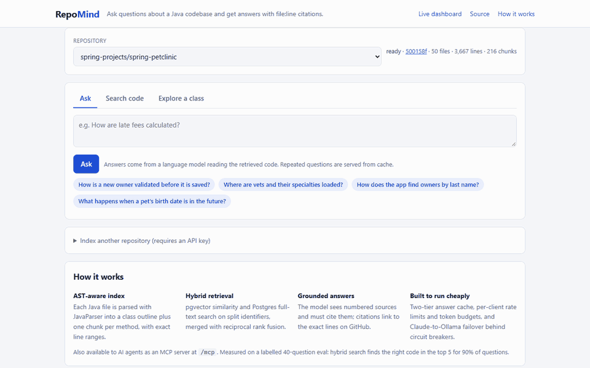
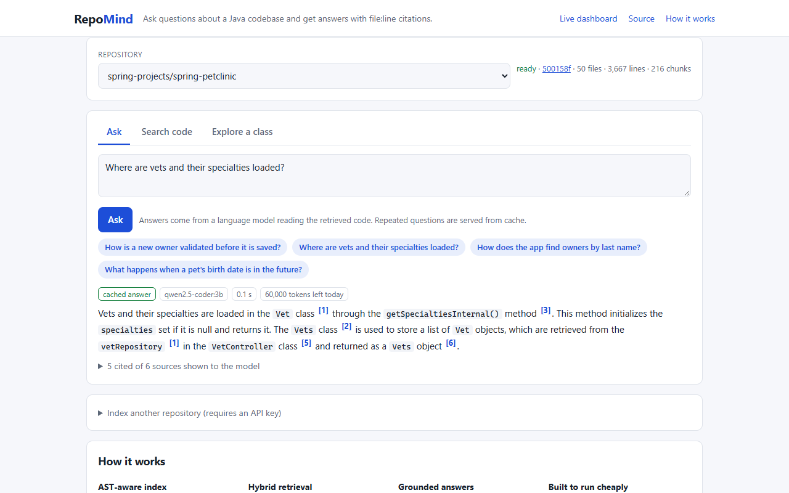
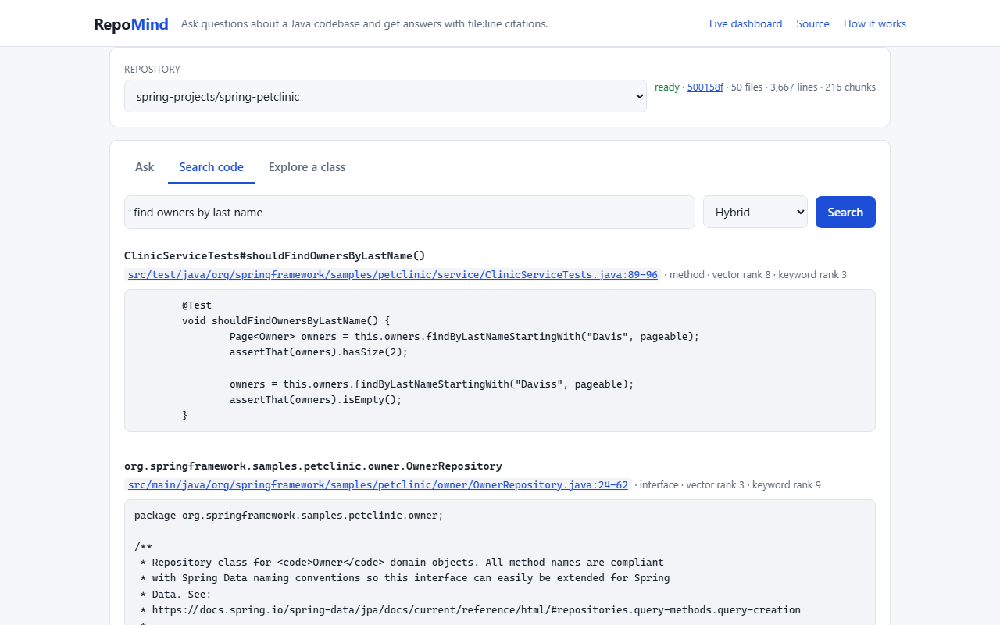
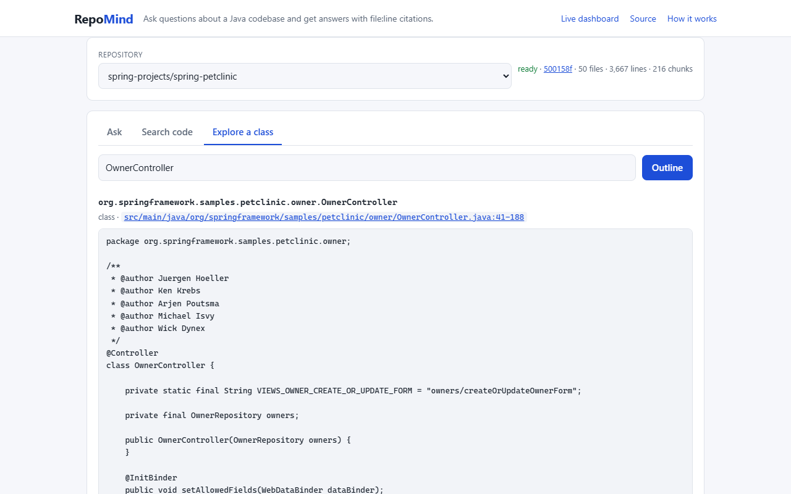
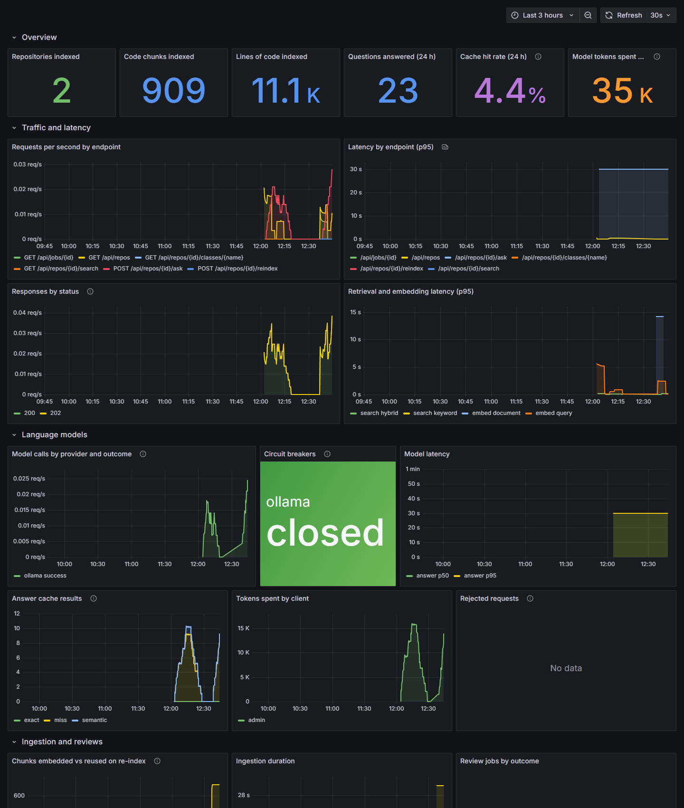

# RepoMind — Codebase Intelligence Service

RepoMind ingests a GitHub Java repository and answers questions about it with file/line citations,
reviews pull requests, and exposes itself as an **MCP server** so AI agents can query codebases.

The interesting part is the backend engineering around the LLM: asynchronous ingestion, AST-aware
chunking, hybrid retrieval, caching, cost control, provider fallback and measured accuracy.

> All six roadmap phases are complete; see the roadmap and evaluation results below.

**Try it:** [recorded demo](https://ayush0612005.github.io/repomind/), the real web UI replaying responses
recorded from a running instance (clickable examples, no server needed). For a live instance, one
command starts the whole stack and prints a public link; see [Live demo](#live-demo).



| Cited answers | Hybrid search | Class outlines |
|---|---|---|
|  |  |  |

<details><summary>Operations dashboard (Grafana)</summary>



</details>

## Tech stack

| Area | Choice |
|---|---|
| Runtime | Java 25, Spring Boot 4.1, Spring AI 2.0 |
| Code parsing | JavaParser — AST-based chunking by class/method with metadata |
| Vector store | PostgreSQL 18 + pgvector, hybrid search (vector + full-text) |
| LLMs | Anthropic Claude (primary) via Spring AI, Ollama local model (dev + fallback) |
| Ingestion | Kafka topics for ingest and review jobs, state tracked in Postgres |
| Caching / limits | Redis exact-answer cache + pgvector semantic cache, per-client rate limits and daily token budgets in Redis |
| Integrations | GitHub REST API + webhooks (PR opened → review comments) |
| Agent access | MCP server (Streamable HTTP) exposing `search_code`, `explain_class`, `ask_codebase` |
| Evaluation | 40-question retrieval eval gating CI; opt-in end-to-end answer eval with real models |
| Ops | Testcontainers, GitHub Actions, Micrometer metrics, Resilience4j, Docker Compose |

## Roadmap

- [x] **Phase 1 — Ingestion:** clone repo, JavaParser chunking, embeddings into pgvector via async Kafka jobs, status API
- [x] **Phase 2 — Q&A API:** hybrid retrieval + answers with file/line citations
- [x] **Phase 3 — Evals:** 30–50 question eval set, accuracy score in CI
- [x] **Phase 4 — Cost control:** response + semantic cache, token budgets, provider fallback to Ollama
- [x] **Phase 5 — PR review:** GitHub webhook → diff analysis → review comments
- [x] **Phase 6 — MCP server:** expose tools to agents, tested from an MCP client

## API

| Method | Path | Purpose |
|---|---|---|
| `POST` | `/api/repos` | Track a GitHub repository (`{"repository": "owner/name"}`) and queue ingestion |
| `POST` | `/api/repos/{id}/reindex` | Re-ingest; unchanged chunks reuse their embeddings |
| `GET` | `/api/repos`, `/api/repos/{id}`, `/api/jobs/{id}` | Repository and ingestion progress |
| `GET` | `/api/repos/{id}/search?q=…&mode=HYBRID\|VECTOR\|KEYWORD` | Ranked code chunks with `file:line` citations |
| `POST` | `/api/repos/{id}/ask` | Answer a question (`{"question": "…"}`) from retrieved code, citing sources |
| `POST` | `/api/repos/{id}/ask-jobs` | The same, for clients behind a proxy that times out slow answers: `200` with the answer if it is ready within 20 s, else `202` with a `Location` to fetch it from |
| `GET` | `/api/ask-jobs/{id}` | A submitted question: `200` with the answer, or `202` while the model is still working (waits up to 20 s) |
| `POST` | `/api/repos/{id}/pulls/{n}/review` | Preview a review of a pull request without posting it |
| `POST` | `/api/repos/{id}/pulls/{n}/reviews` | Queue a review of the PR's head commit and post it to GitHub |
| `GET` | `/api/review-jobs/{id}` | Review job status and the posted review's URL |
| `POST` | `/api/github/webhook` | GitHub `pull_request` webhook: reviews each new commit automatically |

Errors use RFC 9457 problem details.

### MCP server

RepoMind is also an [MCP](https://modelcontextprotocol.io) server (Streamable HTTP at `/mcp`), so
coding agents can query indexed repositories directly:

| Tool | Returns |
|---|---|
| `list_repositories` | Indexed repositories with status and commit |
| `search_code` | Hybrid search hits with `file:line` locations and source |
| `explain_class` | A type's skeleton, every method with its location, and code that refers to it |
| `ask_codebase` | A cited answer from RepoMind's model (counts against the caller's token budget) |

The first three return data rather than prose: the agent has its own model and does better
reasoning over exact code than over a summary. `/mcp` shares the API keys, rate limits and token
budgets of `/api`. To connect Claude Code:

```bash
claude mcp add --transport http repomind http://localhost:8080/mcp --header "X-Api-Key: $REPOMIND_KEY"
```

`McpServerIT` drives the server with the official MCP Java SDK client over a real HTTP port.

### Answer cache

`/ask` checks two cache tiers before spending a model call, both scoped to the repository's
current index generation, so re-indexing invalidates every cached answer for the old code:

- **Exact (Redis):** the same question up to case, spacing and trailing punctuation. Served before
  the question is even embedded.
- **Semantic (pgvector):** an earlier question whose embedding has cosine similarity ≥ 0.97. The
  threshold is deliberately high, since "how many books can a *premium* member borrow" and "…a
  *standard* member…" embed very closely but have different answers. Semantic hits report the
  matched question and similarity in `cache`, so clients can label them.

Failed answers are never cached, and a Redis outage degrades to the semantic tier rather than
failing requests. Hit and miss counts are exported as `repomind.qa.cache` metrics.

### API keys, rate limits and token budgets

With `REPOMIND_LIMITS_ENABLED=true`, every `/api` request is identified by its `X-Api-Key` (or
`Authorization: Bearer`) header. Clients are configured under `repomind.limits.clients` with the
SHA-256 of their key, never the key itself, and requests without a key fall back to a per-IP
anonymous policy (remove it to require keys).

- **Rate limit:** a token bucket per client in Redis, updated by one atomic Lua script using
  Redis's clock, so concurrent requests and multiple app instances agree. Responses carry
  `X-RateLimit-Limit` / `X-RateLimit-Remaining`; rejections are `429` with `Retry-After`.
- **Daily token budget:** model tokens (provider-reported, estimated when a provider reports none)
  per client per UTC day. It is checked immediately before a model call, so cache hits and requests
  that never reach the model are free even when the budget is spent. Model-backed responses carry
  `X-Token-Budget-Remaining`; an exhausted budget is `429` with `Retry-After` set to midnight UTC.
- If Redis is unavailable, limits fail open (and count `repomind.limits.errors`) rather than taking
  the API down. GitHub webhooks are exempt: they are authenticated by signature.

### Provider fallback

Claude and the local Ollama model are both configured, and every model call goes through
`ChatGateway`, which tries them in `repomind.chat.order` (Claude first) and moves on when one fails.
Each provider has a Resilience4j circuit breaker: after repeated failures (50% of the last 10
calls, at least 4) the provider is skipped outright for 30 s, so requests stop paying its timeout
before falling back, and then a single probe call tests whether it has recovered. Spring AI's own
retries are cut from 10 attempts to 2 so a failure surfaces in seconds, not minutes. Calls,
fallbacks and skips are counted in `repomind.chat.calls`, and each breaker's state is the
`repomind.chat.circuit.state` gauge.

`ProviderFailoverLiveIT` (opt-in, like the live eval) runs the production setup with Claude
unreachable: the first four questions fall back to Ollama after a fast failure, the circuit opens,
and later questions skip Claude entirely. To run on Ollama alone, set `SPRING_AI_MODEL_CHAT=ollama`.

### GitHub setup

- `GITHUB_TOKEN`: a token with *Pull requests: read and write* on the repository. Reading public
  repositories works without one; posting reviews requires it.
- `GITHUB_WEBHOOK_SECRET`: add a webhook to the repository pointing at `/api/github/webhook` with
  content type `application/json`, this secret, and the *Pull requests* event. Deliveries are
  verified with `X-Hub-Signature-256`, and each commit is reviewed at most once, so redeliveries
  are harmless. Reviews are posted as comments; RepoMind never approves or blocks a merge.

## Evaluation

The eval set is a fixed fixture codebase (a 23-file library-management service in
`src/test/resources/eval/library`) and `src/test/resources/eval/questions.json`: 40 questions,
each labelled with the code that answers it and the facts a correct answer states, plus 8
questions about things the code does not contain. Both evals ingest the fixture through the real
pipeline (git clone, AST chunking, embedding, Kafka).

**Retrieval, in CI** (`RetrievalEvalIT`): recall@k and MRR per search mode, published to the CI
job summary. The build fails if any mode drops below its recorded baseline. CI runs offline with
a deterministic hashing embedder, so it gates regressions in chunking, indexing, keyword search and
fusion rather than measuring a real embedding model.

**End to end, with real models** (`LiveEvalIT`, opt-in): the same retrieval with real embeddings,
then every question answered by the chat model and checked for citations of the expected code,
stated facts, and declining questions the code cannot answer. Latest run, on a 6 GB laptop GPU
with `nomic-embed-text` and `qwen2.5-coder:7b`
([full report with every answer](docs/eval/live-2026-10-19-qwen2.5-coder-7b.md)):

| Retrieval | Recall@5 | MRR@10 |
|---|---|---|
| Hybrid | **90.0%** | 0.679 |
| Vector only | 87.5% | 0.714 |
| Keyword only | 75.0% | 0.580 |

| Answers | |
|---|---|
| Cite the expected code | 77.5% |
| Fact recall | 90.0% |
| Unanswerable questions correctly declined | 8 / 8 |
| Answerable questions wrongly declined | 0 / 40 |
| Latency p50 / p95 | 5.0 s / 8.9 s |

What it surfaced: hybrid search finds the most answers, but fusing keyword results costs some
ranking precision against vector alone; when retrieval missed the controller, the 7B model invented
an endpoint (`/api/books/checkout`) instead of declining; and one correct answer named the code
without `[n]` citation markers. Fact matching is by accepted spellings, so it slightly undercounts
correct answers phrased differently.

To run it (models are pulled once into the Ollama volume):

```bash
docker compose up -d ollama
docker exec repomind-ollama-1 ollama pull nomic-embed-text
docker exec repomind-ollama-1 ollama pull qwen2.5-coder:7b
REPOMIND_EVAL_LIVE=true ./mvnw verify -Dtest=none -Dsurefire.failIfNoSpecifiedTests=false -Dit.test=LiveEvalIT
```

Set `REPOMIND_CHAT_PROVIDER=anthropic` and `ANTHROPIC_API_KEY` to evaluate Claude instead.

## Web UI, dashboard and deployment

- **Web UI** (`/`): pick an indexed repository, ask questions (citations link to the exact lines on
  GitHub at the indexed commit), search code with each hit's vector and keyword rank, and explore
  class outlines. Indexing new repositories needs an API key.
- **Operations dashboard** (`/grafana/`, public and read-only): request rate and latency, answer-cache
  hit rate, model calls by provider with circuit-breaker state, model latency, tokens spent per
  client, rate-limit rejections, ingestion and review jobs, and JVM health. Prometheus scrapes
  `/actuator/prometheus` over the internal network; the dashboard is generated from
  `deploy/grafana/build_dashboard.py`.
- **Production stack** (`deploy/compose.prod.yaml`): Postgres + pgvector, Kafka, Redis, Ollama, the
  app, Prometheus, Grafana and Caddy, which serves HTTPS automatically on an `sslip.io` hostname
  and keeps `/actuator` off the internet. `deploy/setup-vm.sh` provisions a fresh Ubuntu VM in one
  command, and `deploy/bootstrap-demo.sh` indexes the demo repositories and pre-warms the answer
  cache.
- **Slow models behind proxies:** a CPU-only model can take minutes per answer, longer than a
  proxy's idle timeout (Cloudflare and most hosting proxies cut requests at 60–100 s). The UI
  therefore uses `/ask-jobs`: the request waits up to 20 s, then returns `202` and the answer is
  long-polled, so no single request runs long.
- **Single-container image** (`deploy/huggingface/`): every service in one image on port 7860 with
  the demo data restored at boot, built for a Hugging Face Docker Space (now a paid feature).

### Recorded demo

[ayush0612005.github.io/repomind](https://ayush0612005.github.io/repomind/) is the same
`index.html`, served by GitHub Pages. On a static host it replays responses that
`deploy/pages/record.mjs` recorded from a running instance: the suggested questions
(`qwen2.5-coder:7b` on a laptop GPU), searches in all three modes, and class outlines. The
`Demo site` workflow republishes it when the UI or the recording changes.

### Live demo

On a PC with Docker Desktop and an NVIDIA GPU, one command runs the full stack with the 7B model
on the GPU (10–25 s per new answer) and opens a [Cloudflare quick
tunnel](https://developers.cloudflare.com/cloudflare-one/connections/connect-networks/do-more-with-tunnels/trycloudflare/),
which needs no account or open ports:

```powershell
powershell -ExecutionPolicy Bypass -File deploy\live-demo.ps1          # prints https://<random>.trycloudflare.com
powershell -ExecutionPolicy Bypass -File deploy\live-demo.ps1 -Stop    # stop; data is kept
powershell -ExecutionPolicy Bypass -File deploy\live-demo.ps1 -Remove  # delete everything (~21 GB)
```

The link changes on every start and works while the PC is on. Starting works from nothing:
Docker downloads the images, the database is restored from `deploy/snapshot/repomind.dump` (the
two indexed demo repositories and their cached answers, 4 MB), and the models are pulled, so the
first start after `-Remove` downloads about 14 GB. `-Remove` saves the database back to the
snapshot first, so anything indexed or cached during a demo survives. It needs `deploy/.env` (from
`deploy/.env.example`, with `SITE_ADDRESS=:80` and `HTTP_PORT=8088`).

#### Give the space back to D:

Docker keeps its data in one disk file that grows but never shrinks, so `-Remove` frees space
inside it, not on the drive. To shrink the file, quit Docker Desktop, then in PowerShell **as
administrator**:

```powershell
wsl --shutdown
diskpart
```

and in diskpart (the file is under Docker Desktop's *Settings → Resources → Advanced → Disk image
location*; this machine keeps it on D:):

```text
select vdisk file="D:\DockerData\DockerDesktopWSL\disk\docker_data.vhdx"
attach vdisk readonly
compact vdisk
detach vdisk
exit
```

## Running locally

Prerequisites: JDK 25, Docker (with NVIDIA GPU support for Ollama, optional).

```bash
docker compose up -d                 # Postgres + pgvector, Kafka, Ollama
./mvnw spring-boot:run
```

Tests use Testcontainers and need a running Docker daemon:

```bash
./mvnw verify
```
